<p align="center">
  
</p>

<p align="center">
  <a href="https://github.com/nikunj-alt/BIZZ-TYCOON/actions/workflows/pylint.yml">
    
  </a>
  <a href="LICENSE">
    
  </a>
  
  
  
  
  
</p>

# GASTECT: IoT Gas Leak & Fire Detection System

> Built for **Bizz Tycoons Competition (December 15, 2026)**.  
> Affordable, dual-hazard (gas + fire) IoT safety system with real-time web dashboard, SQLite history logging, and remote alerts.

---

## 🤔 What is this? (plain English)

GASTECT is a smart safety alarm for homes or small businesses. It watches the air
for **gas leaks** and **fire**, like a smoke alarm — but smarter.

Here's how it works, in simple terms:

1. A small electronic board (**Arduino**) with sensors keeps an eye on the air and on open flames.
2. If levels get too high, it **sounds a loud buzzer** and **glows a color**:
   - 🟢 **Green** = all good
   - 🟡 **Yellow** = be careful, levels are rising
   - 🔴 **Red** = danger — gas or fire risk is high
3. The readings are sent to a small program on your computer (the **bridge**).
4. Your computer shows everything as a **live dashboard in your web browser** — the numbers, a 3D view, and a history of what has happened.

You don't need to know how it works to use it. The dashboard does the thinking for you.

---

## 🧑‍💻 How to use it (step by step, no jargon)

### First-time setup
1. **Plug in the hardware.** Connect the Arduino board (with its gas/flame sensors) to your computer with a USB cable — or pair it over HC-05 Bluetooth.
2. **Install the parts.** Run `./scripts/setup.sh` once.

### Everyday use
1. **Start everything.** Run `./scripts/start.sh` (on Windows, run it in Git Bash).
2. **Open the dashboard.** In your web browser, go to **http://localhost:3000**.
3. **Read the status.** The big number is the gas level. The color tells you if it's safe:
   - 🟢 Green = fine.
   - 🟡 Yellow = levels are creeping up — keep an eye on it.
   - 🔴 Red = danger — evacuate and check for gas/fire.
4. **Control the device from the dashboard:**
   - 🔕 **Silence Alarm** — turn off the buzzer (e.g. after a false alarm).
   - 🔊 **Test Sensors** — run a quick siren self-test.
   - 🚪 **Valve / Servo** — open or close the gas cut-off valve.
   - ⚙️ **Thresholds** — change the levels at which the alarm triggers (safe vs. warning).
5. **Watch the history.** The "History" chart shows past readings, so you can spot trends.

### When you're done
- Leave the browser open and the bridge running, and the system keeps logging.
- To stop, press **Ctrl+C** in the terminal window running the scripts.

---

## 🚀 Quick Start (One Command)

Clone the repository and run the setup script:

```bash
git clone https://github.com/nikunj-alt/BIZZ-TYCOON.git GASTECT_Project
cd GASTECT_Project
./scripts/setup.sh
```

To start the local system (Python WebSocket bridge + Next.js web dashboard):

```bash
./scripts/start.sh
```

Open your browser at **http://localhost:3000**.

---

## 🧱 Architecture

```
┌──────────────┐   Serial (USB / HC-05)   ┌──────────────────┐
│  Arduino Uno │ ───────────────────────▶ │  Python Bridge   │
│  GASTECT    │                          │  bridge.py       │
└──────────────┘                          │  ws://localhost  │
        ▲                                 │  :8765           │
        │ telemetry (JSON, 1 Hz)          └────────┬─────────┘
        │                                        │  │
        │                                        │  └─▶ SQLite (database/history.db)
        │                                        ▼
        │                               ┌──────────────────┐
        └────── commands (silence, ───▶ │  Next.js 14      │
                evacuate, servo,         │  Dashboard       │
                set_threshold, …)        │  localhost:3000  │
                                          └──────────────────┘
```

- **Arduino Uno** reads gas (MQ2), flame, LDR, PIR motion, touch, joystick and battery voltage, classifies status, and streams JSON telemetry over serial at 1 Hz.
- The **Python bridge** (`bridge.py`) parses telemetry, classifies it against thresholds, persists every reading to SQLite, and broadcasts it to connected WebSocket clients. It also relays validated commands back to the device.
- The **Next.js dashboard** (TypeScript) subscribes to the WebSocket for live data and reads history from `/api/history`.

### Threshold model (two-level)

| Level | Condition | Status |
|-------|-----------|--------|
| SAFE | below `safe` | 🟢 SAFE |
| WARNING | `safe` … `warning` − 1 | 🟡 WARNING |
| DANGER | at or above `warning` | 🔴 DANGER |

Defaults: gas `200/500`, flame `200/400`. Overall status escalates to DANGER if **either** sensor reaches its warning threshold. Thresholds are tunable at runtime via `set_threshold` and persist back to `config/config.yaml`.

---

## 📂 Project Structure

```
GASTECT_Project/
├── .gitignore
├── LICENSE
├── PRD_setup.md
├── README.md
├── vercel.json
├── Dockerfile
├── arduino/
│   └── GASTECT_Arduino.ino          # C++ Arduino firmware (fixed-size buffers, non-blocking)
├── bridge/
│   ├── bridge.py                    # Python serial-to-WebSocket bridge
│   ├── init_db.py                   # SQLite history DB initializer
│   ├── test_bridge.py               # Unit tests (status, thresholds, commands)
│   └── requirements.txt             # Python dependencies
├── config/
│   ├── config.yaml                  # YAML configuration (port, baud, thresholds)
│   └── bridge.ini                   # INI configuration alternative
├── database/
│   └── history.db                   # SQLite historical logs
├── scripts/
│   ├── setup.sh                     # Environment setup
│   ├── start.sh                     # Local launch script
│   └── start-vercel-mode.sh         # Tunnel + Vercel launcher
├── website/                         # Next.js 14 (TypeScript)
│   ├── pages/
│   │   ├── index.tsx                # Live dashboard (3D, cards, controls)
│   │   ├── about.tsx                # Project info & team
│   │   └── api/history.ts           # SQLite history endpoint (graceful degradation)
│   ├── components/
│   │   ├── ui/                      # AlertBanner, ControlPanel, HeroSection,
│   │   │                            # HistoryChart3D, Navigation, ReadingCard, SensorGrid, Footer
│   │   ├── three/                   # 3D visualizations (plain + R3F)
│   │   └── providers/
│   ├── styles/
│   │   ├── design-system.css        # Design tokens (colors, spacing, radii)
│   │   └── globals.css
│   ├── package.json
│   └── tsconfig.json
└── docs/
    ├── api_spec.md                  # WebSocket contract & REST API spec
    ├── test_protocols.md            # Demo test scenarios
    └── pitch_notes.md               # 3-minute Shark Tank pitch script
```

---

## 🛠️ Hardware Stack (Target BOM: ₹1200)

| Component | Function | Pin / Interface |
|-----------|----------|-----------------|
| **Arduino Uno** | Microcontroller | USB / Serial |
| **MQ2 Sensor** | LPG/Smoke/Methane PPM | Analog A0 |
| **Flame Sensor** | IR fire detection | Analog A1 |
| **LDR** | Day/night ambient light | Analog A2 |
| **PIR Sensor** | Motion detection | Digital 2 |
| **Touch Sensor** | Alarm silence button | Digital 3 (INPUT_PULLUP) |
| **Joystick** | Manual override / navigation | Analog A3/A4, Digital 4 |
| **RGB Status LEDs** | SAFE/WARNING/DANGER indication | Digital 5/6/7 |
| **Buzzer** | Audible alarm (silenceable) | Digital 8 |
| **Servo Valve** | Gas cut-off valve | Digital 9 |
| **Battery Sense** | Power level monitoring | Analog A5 |
| **HC-05** | Bluetooth module (alternative link) | Serial TX/RX (9600 baud) |

---

## 🌐 Vercel & Remote Mode

For deploying the frontend on Vercel while keeping the physical Bluetooth/serial bridge running locally on your computer:

1. Run `./scripts/start-vercel-mode.sh` to start the bridge and public tunnel (ngrok/Cloudflare). The script cleans up background processes on exit.
2. Set `NEXT_PUBLIC_WS_URL` in Vercel to your public tunnel WebSocket URL.

> **Note:** the `/api/history` endpoint reads a local SQLite file, so on serverless deployments it gracefully returns an empty history rather than failing. Historical data is best viewed from the local dashboard.

---

## ✅ Development & Testing

```bash
# Frontend production build (must pass)
cd website && npm run build

# Python lint (must score ≥ 9.0)
python -m pylint bridge.py init_db.py

# Bridge unit tests
python -m pytest bridge/test_bridge.py
```

---

## 👥 Team Bizz Tycoons
- **Competition Date:** December 15, 2026
- **Repository:** https://github.com/nikunj-alt/BIZZ-TYCOON.git
